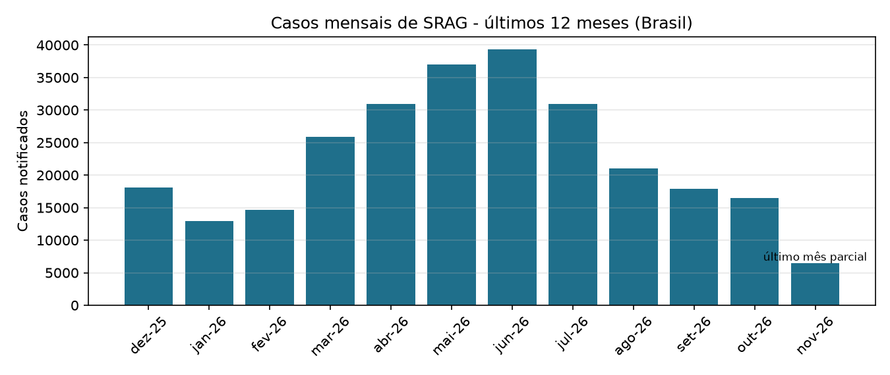

# Relatório de SRAG - Brasil

Data de referência: **2026-11-15** (janela de 30 dias).

## Métricas

| Métrica | Valor | Numerador / Denominador | Definição |
|---|---|---|---|
| Taxa de aumento de casos | -15,6% | 14.221 / 16.853 | Variação % dos casos notificados nos últimos 30 dias vs. os 30 dias anteriores (numerador = casos atuais; denominador = casos do período anterior). |
| Variação vs. mesmo período do ano anterior | -34,7% | 14.221 / 21.764 | Casos dos últimos 30 dias vs. a mesma janela 52 semanas antes (sazonalidade). Dias recentes ainda sofrem atraso de notificação, o que tende a subestimar o valor. |
| Taxa de mortalidade | 4,7% | 322 / 6.793 | Óbitos por SRAG / casos com desfecho conhecido, notificados nos últimos 30 dias. |
| Taxa de ocupação de UTI | 29,7% | 3.565 / 12.022 | Proxy: internações por SRAG que passaram por UTI / internações com informação de UTI, últimos 30 dias. Não considera a capacidade total de leitos. |
| Taxa de vacinação (COVID-19) | 42,4% | 5.971 / 14.066 | Proxy: casos de SRAG que receberam vacina COVID-19 / casos com informação vacinal, últimos 30 dias. Não é cobertura vacinal da população geral. |

## Panorama por UF

**UFs com mais casos** (últimos 30 dias):

| UF | Casos | Casos no período anterior | Variação |
|---|---|---|---|
| SP | 3.607 | 3.777 | -4,5% |
| PR | 1.645 | 1.777 | -7,4% |
| MG | 1.314 | 1.798 | -26,9% |
| RJ | 1.144 | 1.346 | -15,0% |
| RS | 928 | 1.472 | -37,0% |

**UFs com maior crescimento** (mínimo de 100 casos no período):

| UF | Casos | Casos no período anterior | Variação |
|---|---|---|---|
| AC | 180 | 164 | 9,8% |
| ES | 146 | 140 | 4,3% |
| SP | 3.607 | 3.777 | -4,5% |
| PR | 1.645 | 1.777 | -7,4% |
| TO | 110 | 119 | -7,6% |

## Agente etiológico

| Agente | Casos | % dos classificados |
|---|---|---|
| Influenza | 473 | 5,0% |
| Outro vírus respiratório | 3.213 | 34,1% |
| Outro agente etiológico | 120 | 1,3% |
| Não especificado | 4.939 | 52,5% |
| COVID-19 | 668 | 7,1% |

Casos classificados: 9.413. Ainda sem classificação final (em geral os mais recentes): 4.808.

## Gráficos

## Cenário atual

Nos últimos 30 dias, houve uma redução de 15,6% nos casos notificados de Síndrome Respiratória Aguda Grave (SRAG) em comparação com os 30 dias anteriores, indicando uma tendência de queda na incidência da doença no país. Essa diminuição é ainda mais expressiva quando comparada ao mesmo período do ano anterior, com uma queda de 34,7%, o que sugere uma sazonalidade favorável neste momento do ano. Entretanto, é importante considerar que os dados recentes ainda podem estar subestimados devido ao atraso de notificações.

A taxa de mortalidade dos casos com desfecho conhecido está em 4,7%, o que é um indicativo significativo da gravidade dos casos que evoluem para óbito. A taxa de ocupação em unidades de terapia intensiva (UTI) associada a internações por SRAG é de 29,7%, o que mostra que quase um terço dos hospitalizados necessitaram de cuidados intensivos, um proxy da gravidade clínica predominante. A taxa de vacinação contra COVID-19 entre os casos notificados é de 42,4%, representando um percentual considerável, embora inferior à cobertura ideal na população geral.

Esses dados contrastam com algumas notícias que reportam crescimento de casos (ex.: "Casos de síndrome respiratória aguda grave crescem no país" - Agência Brasil), situação que pode ser explicada pelo foco regional dessas manchetes ou por diferenças metodológicas e temporais no acompanhamento dos dados, enquanto a análise nacional apresenta queda consolidada.

## Panorama por UF e agente etiológico

As unidades federativas com maior número absoluto de casos são São Paulo (3.607 casos), Paraná (1.645), Minas Gerais (1.314), Rio de Janeiro (1.144) e Rio Grande do Sul (928). Contudo, todas essas UFs registraram variação negativa no total de casos recentes, evidenciando retração da epidemia nessas regiões.

Entre as UFs com maior crescimento percentual estão Acre (+9,8%) e Espírito Santo (+4,3%), esta última pequena mas com evidência de aumento na doença. Vale destacar que Acre apresentou notícia relacionada a redução da mortalidade ("Acre registra menor número de óbitos por síndrome respiratória aguda grave entre idosos desde 2024" - Agência de Notícias do Acre), o que pode indicar melhora no manejo clínico apesar do aumento de casos.

Quanto ao agente etiológico, entre 9.413 casos já classificados, 34,1% são atribuídos a outros vírus respiratórios (não especificados aqui), 7,1% a COVID-19, 5,0% a Influenza e 1,3% a outros agentes. A maioria (52,5%) permanece sem especificação final, sendo provável que parte dela esteja relacionada aos agentes citados. Há 4.808 casos ainda sem classificação final por agente.

## Contexto das notícias

- A Fundação Oswaldo Cruz (Fiocruz) informou que cinco estados estão em nível de alerta ou risco com sinal de crescimento, o que condiz com o aumento percentual em algumas UFs, como Acre e Espírito Santo, apesar da tendência nacional de queda.
- A notícia do Acre relacionada à menor mortalidade entre idosos confirma os dados de baixa letalidade relativa local, importante destacar para o manejo clínico regional.
- A manchete da Agência Brasil apontando crescimento nacional diverge dos dados nacionais atuais, possivelmente refletindo recortes temporais, atrasos na notificação ou foco regional.
- O G1 destaca Sergipe em nível de alerta, porém essa UF não está entre as maiores em casos totais; pode indicar situação pontual que não impacta ainda a estatística nacional.
- A COSEMS/SP destacou aumento de casos de COVID-19 em São Paulo; os dados atuais mostram ligeira queda na UF, o que pode sugerir que já ocorreu pico recente ou variação local que ainda não foi refletida totalmente.
- Notícias da Prefeitura de Campo Grande ressaltam importância da vacinação e medidas preventivas, alinhadas à taxa proxy informada de vacinação no cenário nacional (42,4%).

## Limitações

Os dados possuem limitações importantes: o atraso na notificação dos casos pode subestimar casos mais recentes, afetando as análises temporais. A alta proporção de casos sem classificação etiológica final (52,5%) dificulta a avaliação precisa da contribuição de cada agente viral. A taxa de ocupação de UTI e de vacinação são proxies calculados apenas sobre os casos notificados, não refletindo necessariamente a situação na população geral ou a capacidade total do sistema de saúde. Além disso, as notícias são baseadas apenas nos títulos, sem análise do conteúdo completo, limitando a completa interpretação.

---

Foram gerados dois gráficos complementares para consulta visual dos casos diários e mensais nos arquivos "casos_diarios_2026-11-15.png" e "casos_mensais_2026-11-15.png".

## Fontes de notícias

- [InfoGripe: cinco estados têm SRAG em nível de alerta ou risco, com sinal de crescimento - Fundação Oswaldo Cruz (Fiocruz)](https://news.google.com/rss/articles/CBMirAFBVV95cUxNVldjcW9TYm1BVDFES3dpSEJpaFEzbndraWFtMkFEUzNSRldvU29NX1QwaEpWVGxZRHhTVkVUSXBEVDlBbFlaeEE2ZkNpWUlKX1h5S1BKNVc4TWt2QUVBbmRDWndZWkVnZ25BbG1uNk51bnd1cTRvRnZ2eDZRbVFnQjZIWkVmMUw4ZGZJRm1PS2hNNjBrWi1lbS1JRGtOM3MtRGZqcUNrZ3dvQldf?oc=5) - Fundação Oswaldo Cruz (Fiocruz), 2026-10-29
- [Acre registra menor número de óbitos por síndrome respiratória aguda grave entre idosos desde 2024 - Agência de Notícias do Acre](https://news.google.com/rss/articles/CBMiwwFBVV95cUxPWnNfaWgyQloxNlJXbHIxV1RHQk1aSWxBd0x4X2djVWV3cUV0MkZ3dkZ6akhCd2huOXFJaUJqY2w5Vm8wNjJVTXNsVUJ6TGRNRmRNX21HdzRocUN5M1d3eWhrRjg1NkN3ZXNjTVFydkdfRW9lNzhMRFdSUURSTlpIUXNhb2ZMTmtnanpWRUV3Z2xhTVdsbHFHZTVaNVpGZG1UQUpnNGNzZXl5NUlSanNlMFY4TXNnY2lnVk84bWhpdkJhN1k?oc=5) - Agência de Notícias do Acre, 2026-10-29
- [Casos de síndrome respiratória aguda grave crescem no país - Agência Brasil](https://news.google.com/rss/articles/CBMizgFBVV95cUxOakRaWUNTOFo0emxwMGtkY0pJTlRqZDNUMWFiOWpnRlRWV2dscGJUX0p6bEFyX1hYVkNGdU4xUmR5UnhpOEpHakwzaWNQR2NPX0lGWlE1N3Jhc1pRMGYtb3ZyQm5TVTNmN045M090V2VJTl9YbkhyRkQ2TGdRQ2steFVyclVuTWFVQUlreUZZOHZBaUlfcm5TcmwzTGtDU0RQT0tVTG52RUsyVEt6WjQteTJFQWs2X2xMcVdFV1FIWVk1bFhqTXdkNWViRXgzQQ?oc=5) - Agência Brasil, 2026-11-05
- [Sergipe é o único estado do país com nível de alerta de crescimento de Síndrome Respiratória Aguda Grave, diz Fiocruz - G1](https://news.google.com/rss/articles/CBMigwFBVV95cUxNUVhtaUdITEhfS3hib19zSzVXalp0R2JhQVZUamppbWRXVVZNVFBKejV5Q05rU1lJVVZydkFrX2ZkYXQ2MEFqdVNWczZQS0tJOXJKSWdyN3RHVUN3RzlBaDdBSnFndURGVi00eFlEaTlSU2ZsUm5lSkZybDRtNzlCRlM1Y9IBkgFBVV95cUxOb3daQVhPaHRYN2VHal8xY3JQM0d6ODgwLXJTa1ZlY21RMmx2cEljRXduZFg5MlJUMzd3N0dkSjFmRVJlU0JGd0xvSjdBaTFva3NER0g3c3czZDNPOXJQa243WDFXcjhEQkYyNy1OQzNyTjduc21xaGlzdGN3RF9tUDd4dGxKb2ZhSUJlNjFMSENGZw?oc=5) - G1, 2026-10-19
- [Cinco estados do Brasil estão em nível de risco para síndrome respiratória - CNN Brasil](https://news.google.com/rss/articles/CBMirwFBVV95cUxOM1RyRk9BNUQ0aERoaFVNd1JXaHFCVVJrZmJvdTZPaXNBVHdWa0N2M0U1cmEya1NESFF5SEpncU5iRlJnUzBnUlh4N2kwR1V2U0Z0RkhHWTFLQTctejVQM0x4c2g5VTFYYU9CU05TMm9HemxXMlk4TEZhdFFnNGV5S0RKOHJUOTUydFd2eURsMFI3Sl9vaEhkcHBnUWphRjN2YkZjQlJrNkVxaTQ5a2d3?oc=5) - CNN Brasil, 2026-10-30
- [Nota Técnica do COSEMS/SP nº 06 – Aumento de casos de SRAG por Covid-19 no estado de São Paulo - COSEMS/SP](https://news.google.com/rss/articles/CBMiygFBVV95cUxOUlNkQXBVLXVGdHNveVkzQWFNVVRzZDN1ZG9PN3Ayb0xZeWl3VERNYTRsUVVMVVNqN1RmQ0tVdXMwOHFRai1VakFQVmFHX0hjT0dxVDZFUkZGa0RFZWppMmVhX2lDRlFLX1BmeVg3MnFxQ3gxd2RnMHRlMnNJeThLYnFnaTBRYkx0OEo4QnNTdGVHQ0xlaEZRT0xLd2pVcExUNFZrVVdFRDRRNnhPVng0cGdOMUNMcHdWRzJZMlNjQjlsSmd0TWpTZUZR?oc=5) - COSEMS/SP, 2026-11-13
- [Sesau reforça importância da vacinação e medidas de prevenção da Covid – CGNotícias - Prefeitura de Campo Grande](https://news.google.com/rss/articles/CBMiwgFBVV95cUxPdkRFVkRoMU5KN1doM2dnSlE3SUFGcGs2RlJxbWotVERWYUtTeTFNN3YzUFg5VFh6Ulh0Z1djcUlURmY3bUlfV2VMc082bkctQ3NoX21GUUpuSklvc3JxWHl0WkNkUWY4dm9kdXpFdkNyZ2ZTZmZPN3lGYkFMUi1jc0FZQ0R2N2JlTXF0RE8tOU5Od3NaemV3dV9pY0RVVkM5X3ZPUW41Mk1LclM3Sk1LWVBMNXc4R0w3VVRqM2xWMFRQZw?oc=5) - Prefeitura de Campo Grande, 2026-11-11
- [Fiocruz identifica aumento de casos graves por três vírus respiratórios no Brasil - cff.org.br](https://news.google.com/rss/articles/CBMi1wFBVV95cUxNN0hTVGFnb3pqWGxoRENCRzF5REFkLVlGejhLUU4xbDhsbGlsaTRCY211NWROUkEycldWUDl0NU4tSDZRRkQybWI0SEQ1bm9IRERKQldUMF9aU1lwRjhFcHAyOFk2cWN0SmJnWExfZjZ6MnJ1S3dvRzRwbXRSdzJReUVZaDkyVmFsQldYczlOTWdQRlp4TnczRGNRVndMczJWd2N1amJ3NWJtb242LVlTaXJNMWE5Qkc0MEFpQjBndk9NTHNKWEFVb2g2Q1dZMHhEM1VKOE5jZw?oc=5) - cff.org.br, 2026-11-10

## Qualidade dos dados (tratamento staging → marts)

| Etapa de tratamento | Linhas |
|---|---|
| Linhas lidas do CSV (staging) | 585.334 |
| Descartadas: data de notificação ausente, pré-2019 ou futura | 0 |
| Descartadas: notificações duplicadas | 0 |
| Linhas válidas após o tratamento | 585.334 |
| Internação inferida pela passagem por UTI | 1.418 |
| UF inválida convertida para nulo | 0 |
| Internação com código ignorado (9) convertida para nulo | 781 |
| UTI com código ignorado (9) convertida para nulo | 5.409 |
| Evolução com código ignorado (9) convertida para nulo | 11.442 |
| Vacina COVID com código ignorado (9) convertida para nulo | 6.537 |
| Casos sem UF (entram no total nacional, não nos filtros por UF) | 36 |
| Classificação final fora do domínio convertida para nulo | 0 |
| Casos sem classificação final (fora da composição por agente) | 26.428 |
| Casos sem informação de UTI (excluídos do denominador) | 62.365 |
| Casos sem desfecho (excluídos do denominador da mortalidade) | 55.181 |
| Casos sem informação vacinal (excluídos do denominador) | 6.600 |

> Dados agregados do Open DATASUS (SIVEP-Gripe); casos recentes sofrem atraso de notificação.
> Relatório de apoio à decisão, não substitui avaliação epidemiológica profissional.
