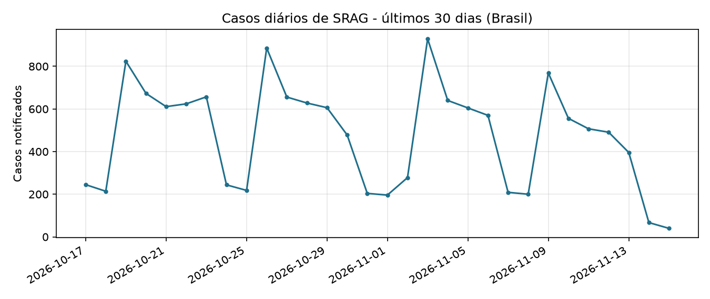

# Relatório de SRAG - Brasil

Data de referência: **2026-11-15** (janela de 30 dias).

## Métricas

| Métrica | Valor | Numerador / Denominador | Definição |
|---|---|---|---|
| Taxa de aumento de casos | -15,6% | 14221 / 16853 | Variação % dos casos notificados nos últimos 30 dias vs. os 30 dias anteriores (numerador = casos atuais; denominador = casos do período anterior). |
| Taxa de mortalidade | 4,7% | 322 / 6793 | Óbitos por SRAG / casos com desfecho conhecido, notificados nos últimos 30 dias. |
| Taxa de ocupação de UTI | 29,2% | 3482 / 11939 | Proxy: internações por SRAG que passaram por UTI / internações com informação de UTI, últimos 30 dias. Não considera a capacidade total de leitos. |
| Taxa de vacinação (COVID-19) | 42,4% | 5971 / 14066 | Proxy: casos de SRAG que receberam vacina COVID-19 / casos com informação vacinal, últimos 30 dias. Não é cobertura vacinal da população geral. |

## Gráficos

## Cenário atual

Com base nos dados consolidados do sistema de vigilância epidemiológica de Síndrome Respiratória Aguda Grave (SRAG) com data de referência em 15/11/2026, apresentam-se os seguintes indicadores:

* **Taxa de aumento de casos:** registrou-se uma variação de **-15.6%** nos casos notificados nos últimos 30 dias (14.221 casos) em relação aos 30 dias imediatamente anteriores (16.853 casos).
* **Taxa de mortalidade:** atingiu **4.7%** (322 óbitos entre os 6.793 casos com desfecho conhecido notificados no período).
* **Taxa de UTI (proxy):** **29.2%** das internações por SRAG com registro sobre uso de terapia intensiva demandaram UTI (3.482 de 11.939 internações com informação preenchida). Ressalta-se que este valor é uma medida *proxy* calculada estritamente sobre os casos notificados, não refletindo a taxa global de ocupação dos leitos hospitalares.
* **Taxa de vacinação COVID-19 (proxy):** **42.4%** dos casos notificados de SRAG com informação de histórico vacinal haviam recebido a vacina contra a COVID-19 (5.971 de 14.066 registros informados). Destaca-se que este indicador é um *proxy* restrito à população de casos notificados no banco, não equivalendo à cobertura vacinal da população geral.

Para o acompanhamento da curva epidemiológica, foram gerados os seguintes gráficos de monitoramento:
* Gráfico de casos diários (últimos 30 dias): `casos_diarios_2026-11-15.png`
* Gráfico de casos mensais (últimos 12 meses): `casos_mensais_2026-11-15.png`

---

## Contexto das notícias

As informações divulgadas recentemente pelos canais de imprensa e órgãos oficiais apontam heterogeneidade regional e atenção contínua para circulação viral:

* [InfoGripe: cinco estados têm SRAG em nível de alerta ou risco, com sinal de crescimento - Fundação Oswaldo Cruz (Fiocruz)](https://news.google.com/rss/articles/CBMirAFBVV95cUxNVldjcW9TYm1BVDFES3dpSEJpaFEzbndraWFtMkFEUzNSRldvU29NX1QwaEpWVGxZRHhTVkVUSXBEVDlBbFlaeEE2ZkNpWUlKX1h5S1BKNVc4TWt2QUVBbmRDWndZWkVnZ25BbG1uNk51bnd1cTRvRnZ2eDZRbVFnQjZIWkVmMUw4ZGZJRm1PS2hNNjBrWi1lbS1JRGtOM3MtRGZqcUNrZ3dvQldf?oc=5) (Fundação Oswaldo Cruz - Fiocruz): Destaca que, apesar da estabilização ou queda agregada nacional, unidades federativas específicas apresentaram sinais de elevação de SRAG.
* [Cinco estados do Brasil estão em nível de risco para síndrome respiratória - CNN Brasil](https://news.google.com/rss/articles/CBMirwFBVV95cUxOM1RyRk9BNUQ0aERoaFVNd1JXaHFCVVJrZmJvdTZPaXNBVHdWa0N2M0U1cmEya1NESFF5SEpncU5iRlJnUzBnUlh4N2kwR1V2U0Z0RkhHWTFLQTctejVQM0x4c2g5VTFYYU9CU05TMm9HemxXMlk4TEZhdFFnNGV5S0RKOHJUOTUydFd2eURsMFI3Sl9vaEhkcHBnUWphRjN2YkZjQlJrNkVxaTQ5a2d3?oc=5) (CNN Brasil): Corrobora o cenário de risco localizado para quadros respiratórios graves.
* [Fiocruz identifica aumento de casos graves por três vírus respiratórios no Brasil - cff.org.br](https://news.google.com/rss/articles/CBMi1wFBVV95cUxNN0hTVGFnb3pqWGxoRENCRzF5REFkLVlGejhLUU4xbDhsbGlsaTRCY211NWROUkEycldWUDl0NU4tSDZRRkQybWI0SEQ1bm9IRERKQldUMF9aU1lwRjhFcHAyOFk2cWN0SmJnWExfZjZ6MnJ1S3dvRzRwbXRSdzJReUVZaDkyVmFsQldYczlOTWdQRlp4TnczRGNRVndMczJWd2N1amJ3NWJtb242LVlTaXJNMWE5Qkc0MEFpQjBndk9NTHNKWEFVb2g2Q1dZMHhEM1VKOE5jZw?oc=5) (cff.org.br): Relata a cocirculação e pressão de diferentes patógenos virais no agravamento de quadros respiratórios.
* [Nota Técnica do COSEMS/SP nº 06 – Aumento de casos de SRAG por Covid-19 no estado de São Paulo - COSEMS/SP](https://news.google.com/rss/articles/CBMiygFBVV95cUxOUlNkQXBVLXVGdHNveVkzQWFNVVRzZDN1ZG9PN3Ayb0xZeWl3VERNYTRsUVVMVVNqN1RmQ0tVdXMwOHFRai1VakFQVmFHX0hjT0dxVDZFUkZGa0RFZWppMmVhX2lDRlFLX1BmeVg3MnFxQ3gxd2RnMHRlMnNJeThLYnFnaTBRYkx0OEo4QnNTdGVHQ0xlaEZRT0xLd2pVcExUNFZrVVdFRDRRNnhPVng0cGdOMUNMcHdWRzJZMlNjQjlsSmd0TWpTZUZR?oc=5) (COSEMS/SP): Alerta serviços de saúde sobre o comportamento epidemiológico recente em âmbito estadual.
* [Acre registra menor número de óbitos por síndrome respiratória aguda grave entre idosos desde 2024 - Agência de Notícias do Acre](https://news.google.com/rss/articles/CBMiwwFBVV95cUxPWnNfaWgyQloxNlJXbHIxV1RHQk1aSWxBd0x4X2djVWV3cUV0MkZ3dkZ6akhCd2huOXFJaUJqY2w5Vm8wNjJVTXNsVUJ6TGRNRmRNX21HdzRocUN5M1d3eWhrRjg1NkN3ZXNjTVFydkdfRW9lNzhMRFdSUURSTlpIUXNhb2ZMTmtnanpWRUV3Z2xhTVdsbHFHZTVaNVpGZG1UQUpnNGNzZXl5NUlSanNlMFY4TXNnY2lnVk84bWhpdkJhN1k?oc=5) (Agência de Notícias do Acre): Apresenta redução da mortalidade proporcional em faixas etárias vulneráveis na localidade.

---

## Limitações

1. **Atraso de notificação e digitação:** Dados epidemiológicos de SRAG sofrem influência de fechamento tardio de fichas e confirmação diagnóstica laboratorial, o que pode subestimar dados dos períodos mais recentes.
2. **Proxies epidemiológicos:**
   * A **taxa de internação em UTI** reflete exclusivamente a proporção de casos graves notificados que utilizaram suporte intensivo entre as fichas com preenchimento deste campo, não indicando a taxa de ocupação da capacidade instalada da rede hospitalar.
   * A **taxa de vacinação** mensura apenas os indivíduos notificados no banco com registro de vacina da COVID-19 sobre aqueles com campo de imunização preenchido, não devendo ser confundida com a cobertura vacinal populacional do Programa Nacional de Imunizações (PNI).
3. **Casos com desfecho pendente:** A taxa de mortalidade considera apenas casos com desfecho final já consolidado (óbito ou cura), podendo variar conforme novos desfechos forem informados.
4. **Fonte das notícias:** O conteúdo jornalístico e notas técnicas externas oferecem contextualização qualitativa e territorial pontual, porém não substituem a análise direta dos microdados oficiais nem representam direcionamento institucional mandatório.

## Fontes de notícias

- [InfoGripe: cinco estados têm SRAG em nível de alerta ou risco, com sinal de crescimento - Fundação Oswaldo Cruz (Fiocruz)](https://news.google.com/rss/articles/CBMirAFBVV95cUxNVldjcW9TYm1BVDFES3dpSEJpaFEzbndraWFtMkFEUzNSRldvU29NX1QwaEpWVGxZRHhTVkVUSXBEVDlBbFlaeEE2ZkNpWUlKX1h5S1BKNVc4TWt2QUVBbmRDWndZWkVnZ25BbG1uNk51bnd1cTRvRnZ2eDZRbVFnQjZIWkVmMUw4ZGZJRm1PS2hNNjBrWi1lbS1JRGtOM3MtRGZqcUNrZ3dvQldf?oc=5) - Fundação Oswaldo Cruz (Fiocruz), 2026-10-29
- [Acre registra menor número de óbitos por síndrome respiratória aguda grave entre idosos desde 2024 - Agência de Notícias do Acre](https://news.google.com/rss/articles/CBMiwwFBVV95cUxPWnNfaWgyQloxNlJXbHIxV1RHQk1aSWxBd0x4X2djVWV3cUV0MkZ3dkZ6akhCd2huOXFJaUJqY2w5Vm8wNjJVTXNsVUJ6TGRNRmRNX21HdzRocUN5M1d3eWhrRjg1NkN3ZXNjTVFydkdfRW9lNzhMRFdSUURSTlpIUXNhb2ZMTmtnanpWRUV3Z2xhTVdsbHFHZTVaNVpGZG1UQUpnNGNzZXl5NUlSanNlMFY4TXNnY2lnVk84bWhpdkJhN1k?oc=5) - Agência de Notícias do Acre, 2026-10-29
- [Casos de síndrome respiratória aguda grave crescem no país - Agência Brasil](https://news.google.com/rss/articles/CBMizgFBVV95cUxOakRaWUNTOFo0emxwMGtkY0pJTlRqZDNUMWFiOWpnRlRWV2dscGJUX0p6bEFyX1hYVkNGdU4xUmR5UnhpOEpHakwzaWNQR2NPX0lGWlE1N3Jhc1pRMGYtb3ZyQm5TVTNmN045M090V2VJTl9YbkhyRkQ2TGdRQ2steFVyclVuTWFVQUlreUZZOHZBaUlfcm5TcmwzTGtDU0RQT0tVTG52RUsyVEt6WjQteTJFQWs2X2xMcVdFV1FIWVk1bFhqTXdkNWViRXgzQQ?oc=5) - Agência Brasil, 2026-11-05
- [Sergipe é o único estado do país com nível de alerta de crescimento de Síndrome Respiratória Aguda Grave, diz Fiocruz - G1](https://news.google.com/rss/articles/CBMigwFBVV95cUxNUVhtaUdITEhfS3hib19zSzVXalp0R2JhQVZUamppbWRXVVZNVFBKejV5Q05rU1lJVVZydkFrX2ZkYXQ2MEFqdVNWczZQS0tJOXJKSWdyN3RHVUN3RzlBaDdBSnFndURGVi00eFlEaTlSU2ZsUm5lSkZybDRtNzlCRlM1Y9IBkgFBVV95cUxOb3daQVhPaHRYN2VHal8xY3JQM0d6ODgwLXJTa1ZlY21RMmx2cEljRXduZFg5MlJUMzd3N0dkSjFmRVJlU0JGd0xvSjdBaTFva3NER0g3c3czZDNPOXJQa243WDFXcjhEQkYyNy1OQzNyTjduc21xaGlzdGN3RF9tUDd4dGxKb2ZhSUJlNjFMSENGZw?oc=5) - G1, 2026-10-19
- [Cinco estados do Brasil estão em nível de risco para síndrome respiratória - CNN Brasil](https://news.google.com/rss/articles/CBMirwFBVV95cUxOM1RyRk9BNUQ0aERoaFVNd1JXaHFCVVJrZmJvdTZPaXNBVHdWa0N2M0U1cmEya1NESFF5SEpncU5iRlJnUzBnUlh4N2kwR1V2U0Z0RkhHWTFLQTctejVQM0x4c2g5VTFYYU9CU05TMm9HemxXMlk4TEZhdFFnNGV5S0RKOHJUOTUydFd2eURsMFI3Sl9vaEhkcHBnUWphRjN2YkZjQlJrNkVxaTQ5a2d3?oc=5) - CNN Brasil, 2026-10-30
- [Nota Técnica do COSEMS/SP nº 06 – Aumento de casos de SRAG por Covid-19 no estado de São Paulo - COSEMS/SP](https://news.google.com/rss/articles/CBMiygFBVV95cUxOUlNkQXBVLXVGdHNveVkzQWFNVVRzZDN1ZG9PN3Ayb0xZeWl3VERNYTRsUVVMVVNqN1RmQ0tVdXMwOHFRai1VakFQVmFHX0hjT0dxVDZFUkZGa0RFZWppMmVhX2lDRlFLX1BmeVg3MnFxQ3gxd2RnMHRlMnNJeThLYnFnaTBRYkx0OEo4QnNTdGVHQ0xlaEZRT0xLd2pVcExUNFZrVVdFRDRRNnhPVng0cGdOMUNMcHdWRzJZMlNjQjlsSmd0TWpTZUZR?oc=5) - COSEMS/SP, 2026-11-13
- [Sesau reforça importância da vacinação e medidas de prevenção da Covid – CGNotícias - Prefeitura de Campo Grande](https://news.google.com/rss/articles/CBMiwgFBVV95cUxPdkRFVkRoMU5KN1doM2dnSlE3SUFGcGs2RlJxbWotVERWYUtTeTFNN3YzUFg5VFh6Ulh0Z1djcUlURmY3bUlfV2VMc082bkctQ3NoX21GUUpuSklvc3JxWHl0WkNkUWY4dm9kdXpFdkNyZ2ZTZmZPN3lGYkFMUi1jc0FZQ0R2N2JlTXF0RE8tOU5Od3NaemV3dV9pY0RVVkM5X3ZPUW41Mk1LclM3Sk1LWVBMNXc4R0w3VVRqM2xWMFRQZw?oc=5) - Prefeitura de Campo Grande, 2026-11-11
- [Fiocruz identifica aumento de casos graves por três vírus respiratórios no Brasil - cff.org.br](https://news.google.com/rss/articles/CBMi1wFBVV95cUxNN0hTVGFnb3pqWGxoRENCRzF5REFkLVlGejhLUU4xbDhsbGlsaTRCY211NWROUkEycldWUDl0NU4tSDZRRkQybWI0SEQ1bm9IRERKQldUMF9aU1lwRjhFcHAyOFk2cWN0SmJnWExfZjZ6MnJ1S3dvRzRwbXRSdzJReUVZaDkyVmFsQldYczlOTWdQRlp4TnczRGNRVndMczJWd2N1amJ3NWJtb242LVlTaXJNMWE5Qkc0MEFpQjBndk9NTHNKWEFVb2g2Q1dZMHhEM1VKOE5jZw?oc=5) - cff.org.br, 2026-11-10

## Qualidade dos dados

- linhas lidas: 585334
- descartadas sem data: 0
- descartadas data fora do intervalo: 0
- linhas validas: 585334

> Dados agregados do Open DATASUS (SIVEP-Gripe); casos recentes sofrem atraso de notificação.
> Relatório de apoio à decisão, não substitui avaliação epidemiológica profissional.
